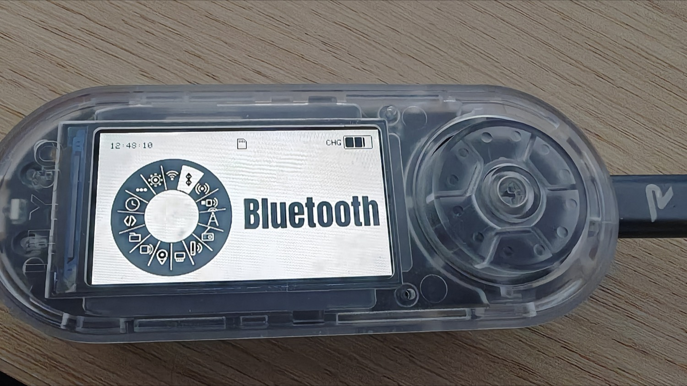
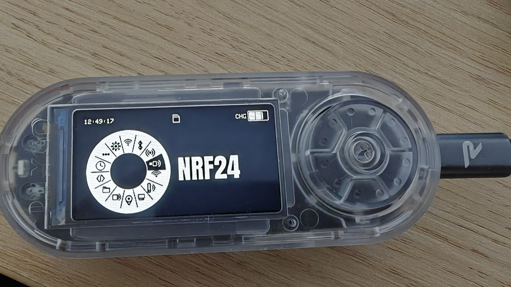
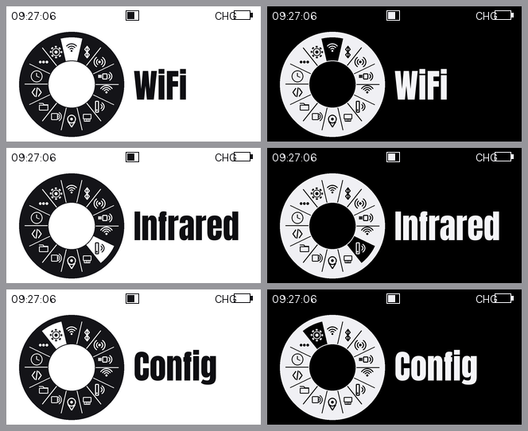

# 🎡 Bruce Wheel Theme

<p align="center">🇺🇸 <a href="README.md">English</a> · 🇫🇷 <b>Français</b></p>

[](https://github.com/BruceDevices/firmware) [](https://github.com/BruceDevices/firmware) [](LICENSE)

Thème UI **« roue radiale »** pour le firmware **[Bruce](https://github.com/BruceDevices/firmware)** (testé sur **LilyGO T-Embed CC1101**, écran 320×170). Chaque entrée du menu affiche une **roue reprenant tous les pictos du menu à gauche** — celui en cours est mis en **surbrillance par inversion** — et le **nom de l'entrée en gros** (police **Anton**) à droite, sur fond monochrome épuré.


## 🎨 Deux variantes

| Variante | Roue | Fond | Texte |
|----------|------|------|-------|
| **Wheel_Light** | noire | blanc | noir |
| **Wheel_Dark**  | blanche | noir | blanc |

| Light (T-Embed) | Dark (T-Embed) |
|-----------------|----------------|
|  |  |

Aperçu des écrans (rendu) :



## ✨ Caractéristiques

- **Roue à gauche** avec les **15 pictos** du menu (WiFi, Bluetooth, RF, NRF24, LoRa, FM, Infrared, Ethernet, GPS, RFID, Files, Scripts, Clock, Others, Config).
- **Picto actif en surbrillance** (inversion) → effet « roue qui tourne » quand on navigue.
- **Titre en gros à droite**, police **Anton** (dynamique, très lisible en petit).
- **Monochrome** propre, cohérent jusque dans les sous-menus (`priColor`/`bgColor`).
- Images **140 px** (hauteur recommandée T-Embed) → **pas de coupe**, calées sous la barre d'état.

## 🚀 Installation

1. Copie le dossier de la variante voulue (**`Wheel_Light`** ou **`Wheel_Dark`**) sur la **carte SD** (ou en LittleFS).
2. Sur l'appareil : **Config → UI Theme → (SD) → sélectionne `theme.json`** du dossier.
3. C'est appliqué immédiatement. Pour revenir en arrière : re-sélectionne un autre thème (ou *Default*).

## 🛠️ Personnalisation / régénération

Le thème est **généré** par [`tools/wheel_theme.py`](tools/wheel_theme.py) (Python + Pillow). Tu peux y changer les **couleurs**, la **police**, la **taille de la roue** ou les **pictos**, puis relancer :

```bash
python3 tools/wheel_theme.py
```

> La police **Anton** (Google Fonts, licence *SIL Open Font License 1.1*) n'est pas incluse : place `Anton.ttf` dans `tools/fonts/` avant de régénérer.

## 📝 Notes

- Le firmware dessine **une image plein écran par entrée**, centrée → la roue + le texte sont **entièrement pré-dessinés** dans chaque PNG (le label natif est désactivé, `label:0`).
- Icônes dessinées en vectoriel (aucune ressource externe), donc faciles à retoucher.
- Testé sur **LilyGO T-Embed CC1101**.

## 🛒 Matériel

*Liens partenaires Amazon : si vous achetez via ces liens, le projet touche une petite commission, sans surcoût pour vous.*

<table>
<tr>
<td align="center" width="33%">
  <a href="https://www.amazon.fr/dp/B0D45MSMJR?linkCode=ll2&amp;tag=koua29bwheeltheme-21&amp;ref_=as_li_ss_tl"></a><br>
  <b><a href="https://www.amazon.fr/dp/B0D45MSMJR?linkCode=ll2&amp;tag=koua29bwheeltheme-21&amp;ref_=as_li_ss_tl">Batterie Anker 545 (10 000 mAh)</a></b><br><sub>Pour faire tourner le T-Embed loin d'une prise</sub>
</td>
<td align="center" width="33%">
  <a href="https://www.amazon.fr/dp/B0C1FCZM94?linkCode=ll2&amp;tag=koua29bwheeltheme-21&amp;ref_=as_li_ss_tl"></a><br>
  <b><a href="https://www.amazon.fr/dp/B0C1FCZM94?linkCode=ll2&amp;tag=koua29bwheeltheme-21&amp;ref_=as_li_ss_tl">Antenne SMA 433 MHz (lot de 2)</a></b><br><sub>Antenne sub-GHz pour la radio CC1101</sub>
</td>
<td align="center" width="33%">
  <a href="https://www.amazon.fr/dp/B0B7NVMBPL?linkCode=ll2&amp;tag=koua29bwheeltheme-21&amp;ref_=as_li_ss_tl"></a><br>
  <b><a href="https://www.amazon.fr/dp/B0B7NVMBPL?linkCode=ll2&amp;tag=koua29bwheeltheme-21&amp;ref_=as_li_ss_tl">microSD SanDisk 64 Go (lot de 2)</a></b><br><sub>Pour les thèmes, scripts et captures Bruce</sub>
</td>
</tr>
</table>

<sub>En tant que Partenaire Amazon, je réalise un bénéfice sur les achats remplissant les conditions requises.</sub>

## ☕ Un café ?


## 📄 Licence

MIT — voir [LICENSE](LICENSE). Par **koua29**. Police *Anton* © The Anton Project (OFL 1.1).
