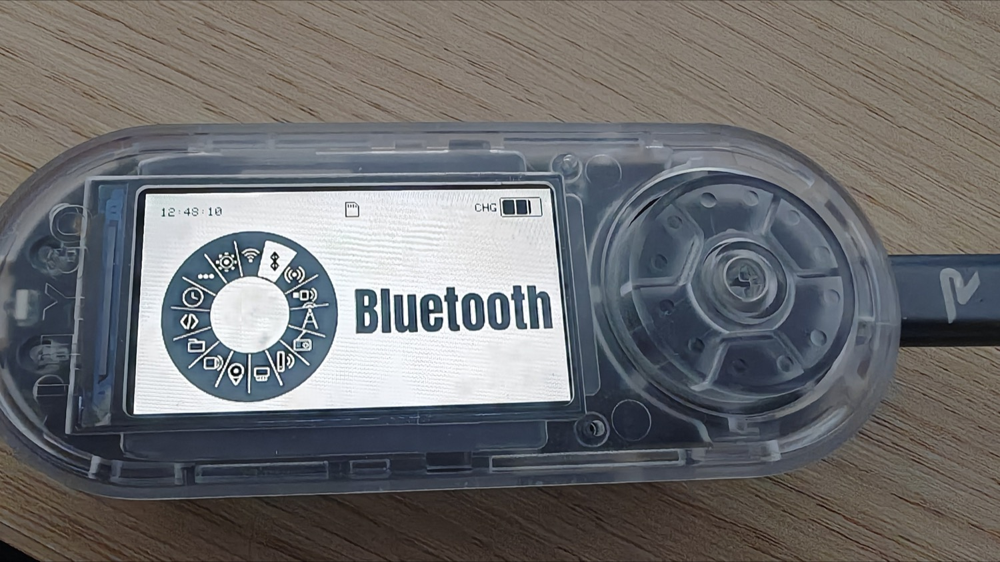
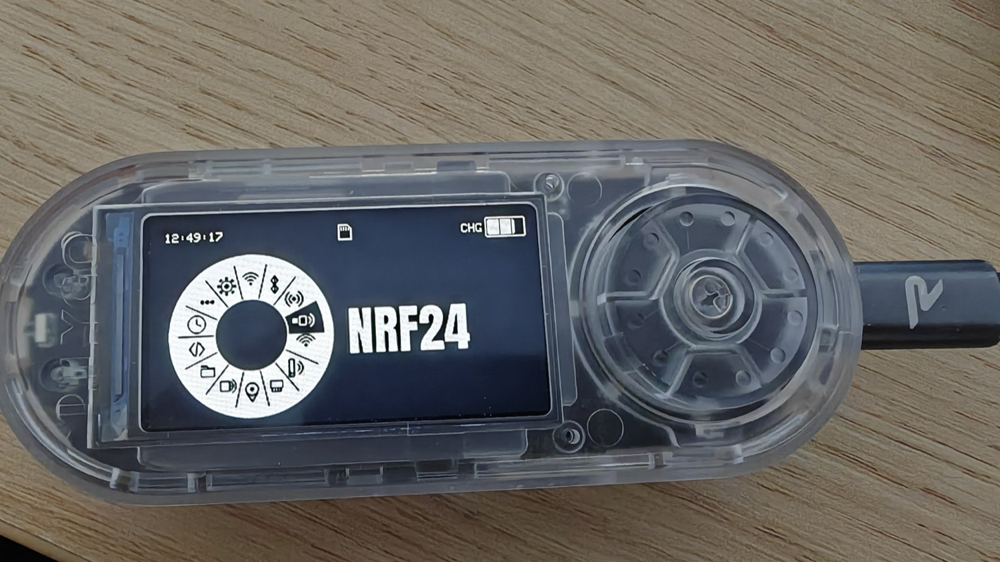
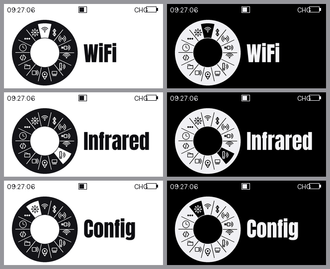

# 🎡 Bruce Wheel Theme

<p align="center">🇺🇸 <b>English</b> · 🇫🇷 <a href="README.fr.md">Français</a></p>

[](https://github.com/BruceDevices/firmware) [](https://github.com/BruceDevices/firmware) [](LICENSE)

A **"radial wheel"** UI theme for the **[Bruce](https://github.com/BruceDevices/firmware)** firmware (tested on the **LilyGO T-Embed CC1101**, 320×170 screen). Every menu entry shows a **wheel with all the menu pictos on the left** — the current one **highlighted by inversion** — and the **entry name in big type** (**Anton** font) on the right, on a clean monochrome background.



## 🎨 Two variants

| Variant | Wheel | Background | Text |
|----------|------|------|-------|
| **Wheel_Light** | black | white | black |
| **Wheel_Dark**  | white | black | white |

| Light (T-Embed) | Dark (T-Embed) |
|-----------------|----------------|
|  |  |

Screen preview (render):



## ✨ Features

- **Wheel on the left** with the **15 menu pictos** (WiFi, Bluetooth, RF, NRF24, LoRa, FM, Infrared, Ethernet, GPS, RFID, Files, Scripts, Clock, Others, Config).
- **Active picto highlighted** (inversion) → "spinning wheel" effect as you navigate.
- **Big title on the right**, **Anton** font (punchy, very readable at small sizes).
- Clean **monochrome**, consistent all the way into the sub-menus (`priColor`/`bgColor`).
- **140 px** images (recommended T-Embed height) → **no cropping**, placed below the status bar.

## 🚀 Installation

1. Copy the folder of the variant you want (**`Wheel_Light`** or **`Wheel_Dark`**) to the **SD card** (or LittleFS).
2. On the device: **Config → UI Theme → (SD) → select the folder's `theme.json`**.
3. It applies immediately. To go back: select another theme again (or *Default*).

## 🛠️ Customizing / regenerating

The theme is **generated** by [`tools/wheel_theme.py`](tools/wheel_theme.py) (Python + Pillow). You can change the **colors**, the **font**, the **wheel size** or the **pictos** there, then run it again:

```bash
python3 tools/wheel_theme.py
```

> The **Anton** font (Google Fonts, *SIL Open Font License 1.1*) is not included: put `Anton.ttf` in `tools/fonts/` before regenerating.

## 📝 Notes

- The firmware draws **one full-screen image per entry**, centered → the wheel + text are **fully pre-drawn** in each PNG (the native label is disabled, `label:0`).
- Icons drawn as vectors (no external resources), so they're easy to tweak.
- Tested on the **LilyGO T-Embed CC1101**.

## 🛒 Hardware

*Amazon affiliate links: if you buy through these links, the project earns a small commission at no extra cost to you.*

<table>
<tr>
<td align="center" width="33%">
  <a href="https://www.amazon.com/dp/B0D45MSMJR?linkCode=ll2&amp;tag=koua29bwheeltheme-20&amp;ref_=as_li_ss_tl"></a><br>
  <b><a href="https://www.amazon.com/dp/B0D45MSMJR?linkCode=ll2&amp;tag=koua29bwheeltheme-20&amp;ref_=as_li_ss_tl">Anker 545 power bank (10,000 mAh)</a></b><br><sub>Keeps the T-Embed running away from an outlet</sub>
</td>
<td align="center" width="33%">
  <a href="https://www.amazon.com/dp/B0C1FCZM94?linkCode=ll2&amp;tag=koua29bwheeltheme-20&amp;ref_=as_li_ss_tl"></a><br>
  <b><a href="https://www.amazon.com/dp/B0C1FCZM94?linkCode=ll2&amp;tag=koua29bwheeltheme-20&amp;ref_=as_li_ss_tl">433 MHz SMA antenna (2-pack)</a></b><br><sub>Sub-GHz antenna for the CC1101 radio</sub>
</td>
<td align="center" width="33%">
  <a href="https://www.amazon.com/dp/B0B7NVMBPL?linkCode=ll2&amp;tag=koua29bwheeltheme-20&amp;ref_=as_li_ss_tl"></a><br>
  <b><a href="https://www.amazon.com/dp/B0B7NVMBPL?linkCode=ll2&amp;tag=koua29bwheeltheme-20&amp;ref_=as_li_ss_tl">SanDisk 64 GB microSD (2-pack)</a></b><br><sub>For Bruce themes, scripts and captures</sub>
</td>
</tr>
</table>

<sub>As an Amazon Associate I earn from qualifying purchases.</sub>

## ☕ Buy me a coffee


## 📄 License

MIT — see [LICENSE](LICENSE). By **koua29**. *Anton* font © The Anton Project (OFL 1.1).
